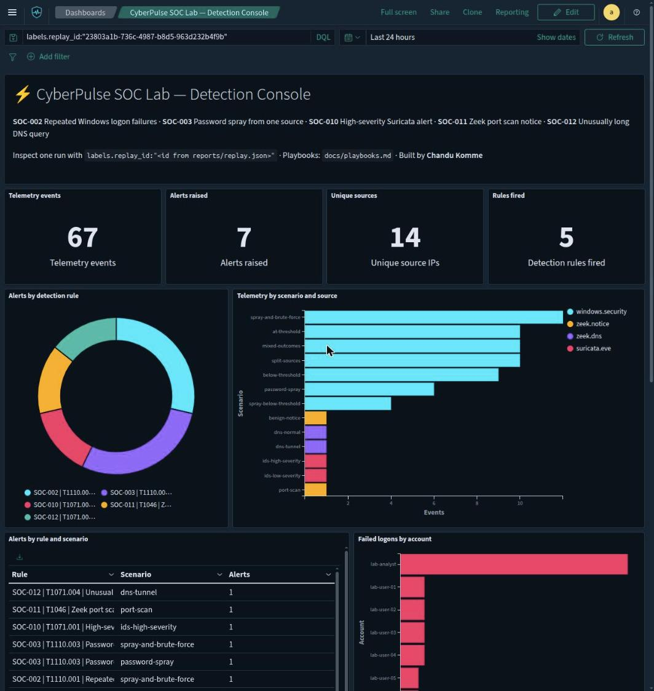
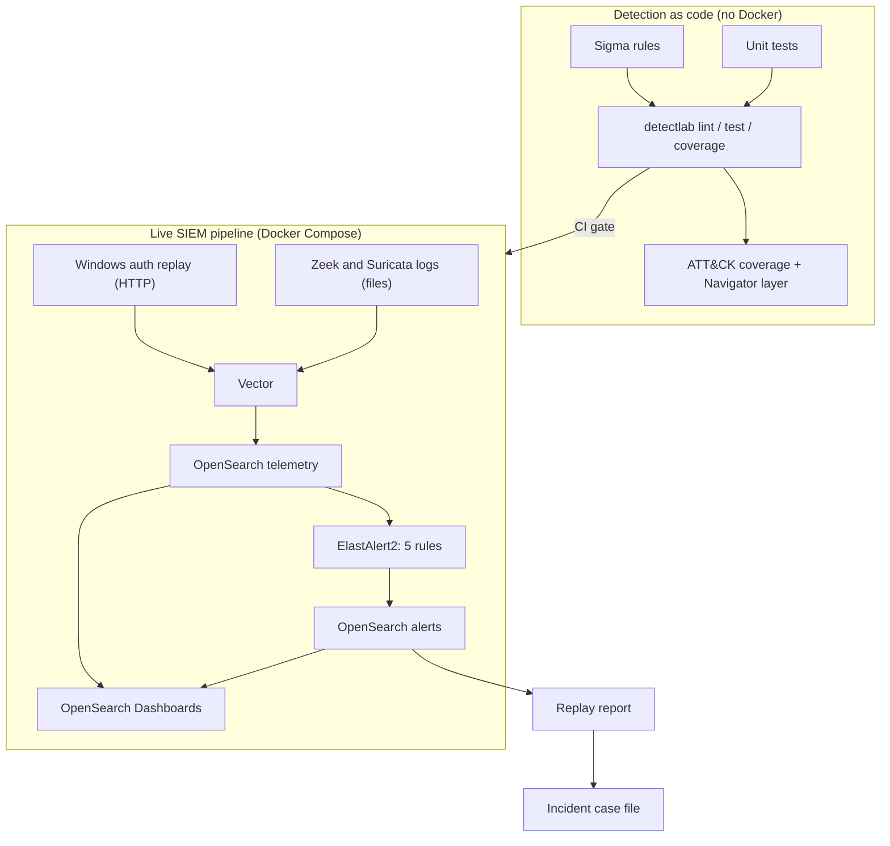
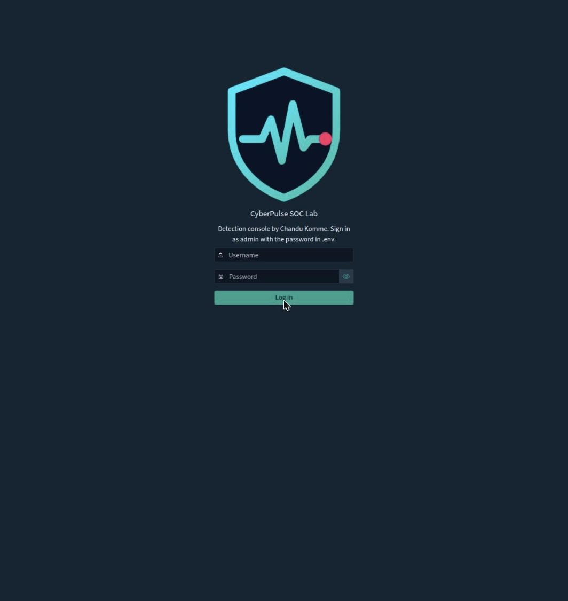
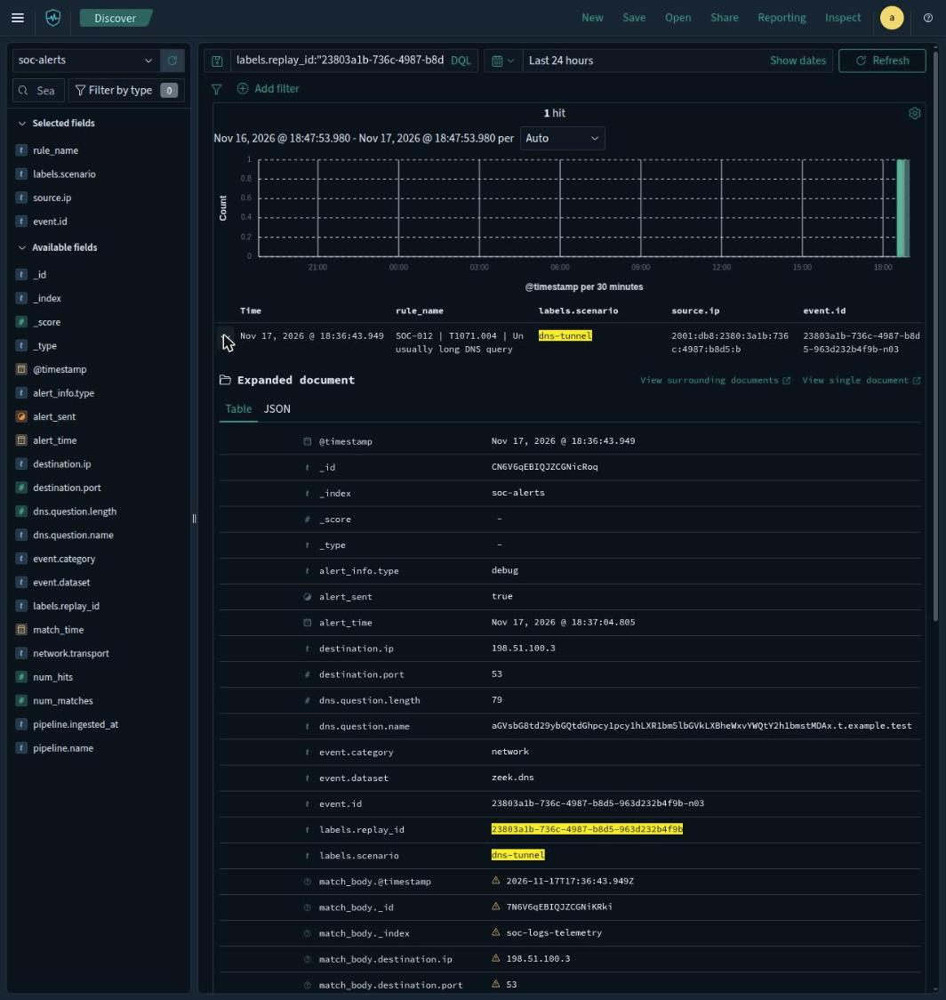
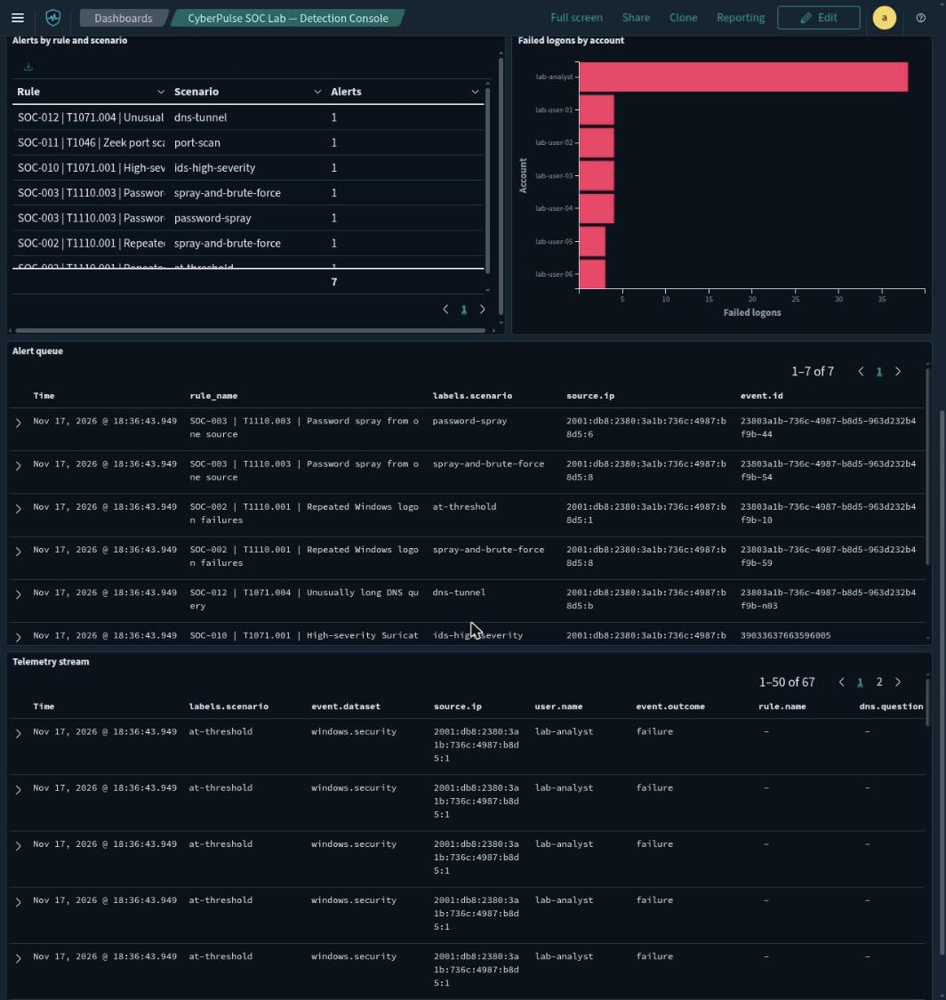

<p align="center"></p>

# CyberPulse SOC Lab

[](https://github.com/ChanduKomme/Detection-Engineering-SOC-Lab/actions/workflows/soc-lab-ci.yml)
[](LICENSE)
[](docs/attack-coverage.md)


**Built and maintained by [Chandu Komme](https://github.com/ChanduKomme).**



A hands-on Security Operations Center lab with its own dark navy + cyan detection console. It treats detections as code. Rules are linted, unit-tested against positive and near-miss events, mapped to MITRE ATT&CK, and then proven end to end on a live SIEM pipeline that replays Windows, Zeek, and Suricata telemetry and checks every alert.

- **Author** — [Chandu Komme](https://github.com/ChanduKomme)
- **Core stack** — Vector · OpenSearch · OpenSearch Dashboards · ElastAlert2
- **Detection as code** — offline Sigma evaluator, rule linter, 52 detection unit tests, ATT&CK Navigator layer
- **Telemetry** — Windows Security authentication, Zeek conn/DNS/notice, Suricata EVE
- **Console** — CyberPulse-branded OpenSearch Dashboards: dark theme, custom logo and login page, auto-imported SOC dashboard
- **Deployment** — Docker Compose on a local lab machine, two-stage GitHub Actions pipeline

## At a glance

| | |
|---|---|
| Live rules verified by replay | **5** (SOC-002, SOC-003, SOC-010, SOC-011, SOC-012) |
| Sigma rules with unit tests | **16 files**, 52 positive and negative cases |
| ATT&CK techniques covered | **17** across 11 tactics — see [coverage](docs/attack-coverage.md) |
| Replay scenarios | **13** (7 Windows, 6 network), each with an expected alert per rule |
| Python test suite | **107 tests** for the evaluator, catalog, replay harness, case reports, and dashboard |
| Detection console | **11 panels**: KPIs, alerts by rule, telemetry by scenario, failed logons by account, alert queue |

## Contents

- [Project overview](#project-overview)
- [Architecture and tooling](#architecture-and-tooling)
- [Detection engineering](#detection-engineering)
- [Detection as code](#detection-as-code)
- [CyberPulse detection console](#cyberpulse-detection-console)
- [Threat hunting and incident response](#threat-hunting-and-incident-response)
- [AI-assisted SOC](#ai-assisted-soc)
- [Requirements and installation](#requirements-and-installation)
- [Configuration and service endpoints](#configuration-and-service-endpoints)
- [Detection validation and evidence](#detection-validation-and-evidence)
- [Local run evidence](#local-run-evidence)
- [Project structure](#project-structure)
- [Lab boundaries](#lab-boundaries)
- [Author](#author)
- [Credits and license](#credits-and-license)

## Project overview

The lab follows the analyst workflow from a raw event to a supported investigation. Each replay run gets a unique ID that appears on the raw fixture, the normalized OpenSearch records, every ElastAlert2 alert, and the generated case file.

1. Write a Sigma rule and its unit tests, then pass the offline lint, test, and coverage gates.
2. Replay Windows Security events and fresh Zeek and Suricata records.
3. Normalize event time, addresses, accounts, DNS length, and signature metadata in Vector.
4. Let ElastAlert2 evaluate five live rules and write alerts back to OpenSearch.
5. Verify the full alert matrix: every expected alert present, no unexpected alert anywhere.
6. Generate an incident case file, follow the playbook, and record a disposition.

### What I built in version 2

| Area | Implemented by Chandu Komme |
|---|---|
| Detection as code | Offline Sigma evaluator with correlations, rule linter, 52 unit tests, generated ATT&CK coverage and Navigator layer |
| New detections | Password spray (live and Sigma), high-severity IDS alert, Zeek port scan and long-DNS live rules, chained brute-force-then-success Sigma correlation |
| Collection | DNS name length, destination port, originator bytes, and record IDs normalized from Zeek and Suricata |
| Validation | Multi-rule alert matrix over 13 Windows and network scenarios, with unexpected alerts treated as failures |
| Response | Incident case-file generator, triage playbooks for every live rule, spray and network hunting queries |
| Engineering | Makefile, pytest suite, and a two-stage CI pipeline with Vector config validation |

See the [changelog](CHANGELOG.md) for the full list, including the version 1 foundation: the Compose stack, index template, SOC-002, and the replay harness.

## Architecture and tooling



| Component | Role |
|---|---|
| Vector | Accepts Windows NDJSON over HTTP, tails Zeek and Suricata logs, and normalizes them into one schema |
| OpenSearch | Stores normalized telemetry and alert history under an explicit index template |
| ElastAlert2 | Runs the frequency, cardinality, and single-event rules and records each evaluation |
| OpenSearch Dashboards | Lets an analyst search events, open an alert, and follow its evidence |
| `detectlab` | Lints, tests, and maps the detection catalog offline |
| `tools/replay.py` | Generates telemetry and verifies every alert end to end |
| `tools/case_report.py` | Turns replay evidence into an analyst case file |

## Detection engineering

### Live rules

| Rule | Technique | Type | Logic | Playbook |
|---|---|---|---|---|
| SOC-002 | T1110.001 Password Guessing | frequency | 10+ failed `4625` logons from one source IP in 5 minutes, 15-minute cooldown | [triage](docs/playbooks.md#soc-002) |
| SOC-003 | T1110.003 Password Spraying | cardinality | Failures against 5+ distinct accounts from one source IP in 10 minutes | [triage](docs/playbooks.md#soc-003) |
| SOC-010 | T1071.001 Web Protocols | any | Suricata alert with priority 1 or 2 | [triage](docs/playbooks.md#soc-010) |
| SOC-011 | T1046 Network Service Discovery | any | Zeek `Scan::Port_Scan` notice | [triage](docs/playbooks.md#soc-011) |
| SOC-012 | T1071.004 DNS | any | Zeek DNS query name of 60+ characters | [triage](docs/playbooks.md#soc-012) |

SOC-002 and SOC-003 look at the same failures from two angles: many attempts against one account versus a few attempts across many accounts. The `spray-and-brute-force` replay scenario triggers both for one source.

### MITRE ATT&CK coverage

| Use case | Technique | Scope |
|---|---|---|
| Repeated Windows logon failures | T1110.001 | Live rule SOC-002 with replay |
| Password spraying | T1110.003 | Live rule SOC-003 with replay |
| Successful logon after a failure burst | T1078 | Chained Sigma correlation with tests |
| High-severity IDS alert | T1071.001 | Live rule SOC-010 with replay |
| Port-scan notices | T1046 | Live rule SOC-011 with replay |
| Long DNS names | T1071.004 | Live rule SOC-012 with replay |
| LSASS access and LLMNR/NBT-NS traffic | T1003.001, T1557.001 | Tested Sigma references |
| Encoded PowerShell and WMIC remote execution | T1059.001, T1027, T1047 | Tested Sigma references |
| Scheduled tasks and registry Run keys | T1053.005, T1547.001 | Tested Sigma references |
| SMB connections and pass-the-hash logons | T1021.002, T1550.002 | Tested Sigma references |
| Large outbound transfers | T1041 | Tested Sigma reference |
| Defender real-time protection disabled | T1562.001 | Tested Sigma reference |

The generated [ATT&CK coverage table](docs/attack-coverage.md) lists the rules and test counts per technique. Load [`attack-navigator-layer.json`](detection-rules/attack-navigator-layer.json) in the [ATT&CK Navigator](https://mitre-attack.github.io/attack-navigator/) for a heat map. See the [Sigma rule notes](detection-rules/README.md) for deployment status and false-positive guidance.

## Detection as code

```bash
pip install -r requirements-dev.txt
make check          # lint + 52 detection tests + coverage check + 107 pytest tests
```

[`detectlab/`](detectlab/) evaluates the Sigma catalog offline: field modifiers, boolean conditions, and `event_count`, `value_count`, `temporal`, and `temporal_ordered` correlations, including a correlation built on another correlation. Each rule file has unit tests in [`tests/detections/`](tests/detections/) with at least one true positive and one near miss — below threshold, outside the window, out of order, from a different source, or excluded by a filter. The linter fails the build if a rule lacks a UUID, ATT&CK tag, false-positive guidance, or tests, or if a live rule breaks the `SOC-NNN | Txxxx | description` convention.

Full guide: [detection as code](docs/detection-as-code.md).

## CyberPulse detection console

OpenSearch Dashboards is rebranded as the CyberPulse console. `setup.sh` mounts the theme and imports the dashboard, so the first page after sign-in is the SOC view.

| Element | What changes |
|---|---|
| Theme | Dark mode locked on, with a navy background and cyan accents |
| Branding | CyberPulse shield-and-pulse logo, header mark, favicon, loading animation, and browser title |
| Login page | CyberPulse title, subtitle, and brand mark |
| Landing page | Opens straight on **CyberPulse SOC Lab — Detection Console** |
| Chart colors | Fixed per data source and per rule, so a color always means the same thing |

| Color | Hex | Data source | Rule |
|---|---|---|---|
| Cyan | `#00E5FF` | Windows Security | SOC-002 brute force |
| Violet | `#8B5CF6` | Zeek DNS | SOC-003 password spray |
| Red | `#FF4D6D` | Suricata, failed logons | SOC-010 IDS high severity |
| Amber | `#FFB020` | Zeek notices | SOC-011 port scan |
| Teal | `#14B8A6` | Zeek connections | SOC-012 DNS tunneling |

The dashboard has KPI tiles (telemetry events, alerts, unique sources, rules fired), an alerts-by-rule donut, telemetry by scenario and data source, an alerts-by-rule-and-scenario table, failed logons by account, the alert queue, and the telemetry stream. It is generated from code by [`tools/build_dashboard.py`](tools/build_dashboard.py) into [`dashboards/cyberpulse-soc-dashboard.ndjson`](dashboards/cyberpulse-soc-dashboard.ndjson), and a test keeps the two in sync. The theme lives in [`config/dashboards/`](config/dashboards/).

## Threat hunting and incident response

Start with the replay ID, identify the source that triggered the alert, then pivot across accounts, hosts, and network records.

| Hunt | Question |
|---|---|
| [Windows logons](threat-hunting/queries/windows-logons.md) | Which sources failed repeatedly, against which accounts? |
| [Password spray](threat-hunting/queries/password-spray.md) | Which sources touched many accounts, and did any account succeed? |
| [Network](threat-hunting/queries/network.md) | What else did a source do across Zeek and Suricata, and which DNS names are longest? |

Every live rule has a [triage playbook](docs/playbooks.md) covering scope, benign explanations, containment, and tuning. `tools/case_report.py` builds a case file from the replay with evidence IDs and a disposition checklist, and the [investigation worksheet](docs/investigation.md) describes what to record and the analyst handoffs to MISP, DFIR-IRIS, Velociraptor, and StackStorm.

## AI-assisted SOC

The [triage prompt](ai-agents/triage-prompt.md) accepts selected, sanitized evidence and asks for a summary, plausible alternatives, and missing evidence. The analyst checks every finding against the indexed data and records the disposition. The exercise works with a locally selected model and requires no model connection to the stack.

## Requirements and installation

- Git, Bash, OpenSSL, Make, and Python 3.11+
- Docker Engine 28+ or current Docker Desktop, with the Docker Compose v2 plugin
- At least 4 GB of memory available to Docker and 10 GB of free disk for the core lab

```bash
git clone https://github.com/ChanduKomme/Detection-Engineering-SOC-Lab.git
cd Detection-Engineering-SOC-Lab
pip install -r requirements-dev.txt   # offline toolchain
make check                            # detection-as-code gates
./setup.sh                            # start the stack
python3 tools/replay.py --report reports/replay.json
python3 tools/case_report.py reports/replay.json -o reports/case.md
```

The first start writes a generated OpenSearch admin password to a local `.env`, waits for the cluster, installs the field mappings, and imports the CyberPulse detection console. Open http://127.0.0.1:5601 and sign in as `admin`. Leave that file in place while using the same OpenSearch data volume. Run `make help` for every shortcut, `./health-check.sh` for service and cluster status, and `docker compose down` to stop the lab while keeping the data.

## Configuration and service endpoints

| Service | Default local endpoint | Use |
|---|---|---|
| CyberPulse console (OpenSearch Dashboards) | http://127.0.0.1:5601 | Sign in as `admin` with the password in `.env` |
| OpenSearch | https://127.0.0.1:9200 | OpenSearch API with the lab certificate |
| Vector | http://127.0.0.1:8688/windows-auth | HTTP POST endpoint for newline-delimited Windows event JSON |
| ElastAlert2 | `docker compose logs elastalert2` | Rule evaluation logs and local alert writeback |

To customize the host ports, add the relevant values from [`.env.example`](.env.example) to the generated `.env` and run `./setup.sh` again. Pass `--collector-port` and `--opensearch-port` to the replay command when those defaults change. The [telemetry guide](docs/telemetry.md) documents the input shapes, normalized fields, and network replay.

## Detection validation and evidence

`tools/replay.py` posts Windows events through Vector and appends fresh Zeek and Suricata records to `telemetry/`. It checks that every record reached OpenSearch with the expected fields, waits until ElastAlert2 has evaluated **every** live rule past the replay time, and compares the alerts per scenario and per rule with the expected matrix. A missing alert, an extra alert, or an alert that cannot be linked to a replayed record fails the run. Use `--scope windows` or `--scope network` to replay one side, and `--dry-run` to print the generated data without a running stack.

| Scenario | Input | Expected alerts |
|---|---|---|
| `at-threshold` | 10 failures from one IP | SOC-002 |
| `below-threshold` | 9 failures from one IP | none |
| `mixed-outcomes` | 9 failures and 1 success from one IP | none |
| `split-sources` | 6 failures from one IP and 4 from another | none |
| `password-spray` | 6 failures across 6 accounts from one IP | SOC-003 |
| `spray-below-threshold` | 4 failures across 4 accounts from one IP | none |
| `spray-and-brute-force` | 12 failures across 6 accounts from one IP | SOC-002 and SOC-003 |
| `port-scan` / `benign-notice` | Zeek notices | SOC-011 / none |
| `dns-tunnel` / `dns-normal` | 79- and 16-character DNS names | SOC-012 / none |
| `ids-high-severity` / `ids-low-severity` | Suricata alerts with priority 1 and 3 | SOC-010 / none |

The JSON report contains the replay ID, event IDs, alert IDs, the expected matrix, and the evaluation time of each rule. Use it with [OpenSearch Dashboards](dashboards/README.md) to capture your own evidence.

[GitHub Actions](https://github.com/ChanduKomme/Detection-Engineering-SOC-Lab/actions/workflows/soc-lab-ci.yml) runs in two stages. The first runs the detection-as-code gates and the pytest suite. The second validates the Vector configuration, starts a fresh Compose stack, runs the full replay, builds the case file, and publishes both as the `replay-evidence` artifact.

## Local run evidence

All proof lives in the separate [`evidence/`](evidence/) folder, collected by Chandu Komme from the running lab on 2026-11-17.

| Check | Result |
|---|---|
| Replays | `70e18092…` and `23803a1b…` (fresh CyberPulse stack) |
| Telemetry events indexed | 67 per replay |
| Alerts | 7 per replay: 0 missing, 0 unexpected, 6 of 6 near misses silent |
| Rule evaluation | All 5 live rules evaluating (77–82 runs each) |
| Independent check | Counts confirmed with direct OpenSearch queries |

| | |
|---|---|
|  |  |
|  |  |

See the [evidence index](evidence/README.md), the [alert matrix](evidence/live-run/alert-matrix.md), [results from OpenSearch](evidence/live-run/opensearch-results.json), and the [terminal output](evidence/terminal/).

## Project structure

| Path | Contents |
|---|---|
| [`docker-compose.yml`](docker-compose.yml) and [`setup.sh`](setup.sh) | Local services and first-run initialization |
| [`config/vector/`](config/vector/) | Collector inputs and normalization |
| [`config/elastalert2/`](config/elastalert2/) | Alert engine and the five live rules |
| [`config/opensearch/`](config/opensearch/) | Index template with explicit field mappings |
| [`config/dashboards/`](config/dashboards/) | CyberPulse console theme, branding assets, and login page |
| [`dashboards/`](dashboards/) | Detection console saved objects and dashboard guide |
| [`detection-rules/`](detection-rules/) | Sigma catalog, mapping notes, and ATT&CK Navigator layer |
| [`detectlab/`](detectlab/) | Offline Sigma evaluator, linter, coverage generator, and CLI |
| [`tests/`](tests/) | Detection unit tests and the pytest suite |
| [`fixtures/`](fixtures/) and [`tools/`](tools/) | Replay scenarios, verification harness, case-file generator, and dashboard generator |
| [`evidence/`](evidence/) | Screenshots, live OpenSearch results, and terminal output from real runs |
| [`threat-hunting/`](threat-hunting/) and [`docs/`](docs/) | Hunts, playbooks, investigation guide, telemetry guide, and coverage |
| [`ai-agents/`](ai-agents/) | Analyst-controlled AI triage prompt |
| [`Makefile`](Makefile) | Shortcuts for every lab task |

## Lab boundaries

Run the stack on a trusted local machine with synthetic or sanitized data. Host ports bind to loopback, and the services use the bundled OpenSearch demo TLS configuration. Keep the replay listener and administrative endpoints local. Replay addresses come from reserved documentation ranges. Threat-intelligence, case-management, and endpoint-forensics handoffs are analyst exercises that require separate tools.

## Author

**Chandu Komme** — designed, built, and validated this lab: the CyberPulse detection console and theme, the Compose deployment, Vector normalization pipeline, five live ElastAlert2 detections, the `detectlab` detection-as-code toolkit with its Sigma evaluator, linter, and ATT&CK coverage generator, the 52 detection unit tests and pytest suite, the Windows and network replay harness and CI pipeline, the incident case-file generator, the triage playbooks and hunting queries, the investigation worksheet, and the AI triage exercise.

- GitHub: [ChanduKomme](https://github.com/ChanduKomme)

## Credits and license

Copyright © 2026 Chandu Komme. Version 1 of this lab started from the [Enterprise Detection Engineering SOC Lab](https://github.com/sandeepmothukuri/Enterprise-Detection-Engineering-SOC-Lab/tree/ec8e4f8ba318b81786a79dcf98fc064f55b4a306) by Sandeep Mothukuri, whose copyright and MIT terms are kept in [LICENSE](LICENSE) as the license requires. Released under the [MIT License](LICENSE).
