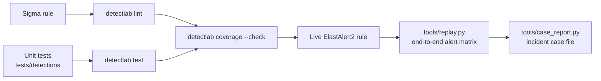

# Detection as code

Every detection in this lab is a reviewed, tested file. The offline toolkit in [`detectlab/`](../detectlab/) runs in seconds without Docker and gates every push in CI before the live SIEM replay starts.



## Commands

| Command | What it does |
|---|---|
| `python -m detectlab lint` | Metadata, UUIDs, ATT&CK tags, false-positive notes, conditions, correlation references, test presence, and live-rule naming |
| `python -m detectlab test -v` | Runs every positive and negative case in `tests/detections/` |
| `python -m detectlab coverage` | Regenerates [attack-coverage.md](attack-coverage.md) and the ATT&CK Navigator layer |
| `python -m detectlab eval RULE EVENTS` | Evaluates one Sigma file against a JSON or NDJSON event file |
| `python -m detectlab all` | The CI gate: lint, test, and coverage check |
| `make check` | All of the above plus the pytest suite |

## The evaluator

[`detectlab/sigma.py`](../detectlab/sigma.py) implements the Sigma subset the catalog uses:

- Field maps (AND), value lists (OR), keyword searches, dotted field paths
- Modifiers `contains`, `startswith`, `endswith`, `all`, `re`, `cidr`, `gt`, `gte`, `lt`, `lte`, `exists`
- Conditions with `and`, `or`, `not`, parentheses, `1 of x*`, `all of them`
- Correlations `event_count`, `value_count`, `temporal`, and `temporal_ordered`, including chained correlations

Unsupported syntax raises an error instead of silently not matching, so a rule can never pass its tests by accident.

## Writing a test

```yaml
rule: detection-rules/sigma/credential-access/T1110.003_password_spray.yml
cases:
  - name: one source fails against six accounts
    expect: match
    events:
      - repeat: 6
        every: 30s
        event: {EventID: 4625, IpAddress: 198.51.100.7, TargetUserName: "user{i}"}
  - name: many failures against a single account is brute force, not spray
    expect: no_match
    events:
      - repeat: 20
        event: {EventID: 4625, IpAddress: 198.51.100.7, TargetUserName: alice}
```

`repeat`, `every`, and `start` build a timeline from a fixed base time, and `{i}` is replaced with the repeat counter. The linter requires at least one `match` and one `no_match` case per rule file. Good negative cases are near misses: one below threshold, outside the window, out of order, or excluded by a filter.

## Adding a detection

1. Write the Sigma rule with a new UUID, `author`, ATT&CK tags, and false positives.
2. Add `tests/detections/<technique>_<name>.yml` with positive and near-miss negative cases.
3. If it should run live, add an ElastAlert2 rule named `SOC-NNN | Txxxx | description` with a `# Sigma source:` comment, then add replay scenarios with the expected alert counts to `fixtures/`.
4. Run `python -m detectlab coverage` and `make check`, then commit the regenerated files.

---
*CyberPulse SOC Lab — by [Chandu Komme](https://github.com/ChanduKomme)*

