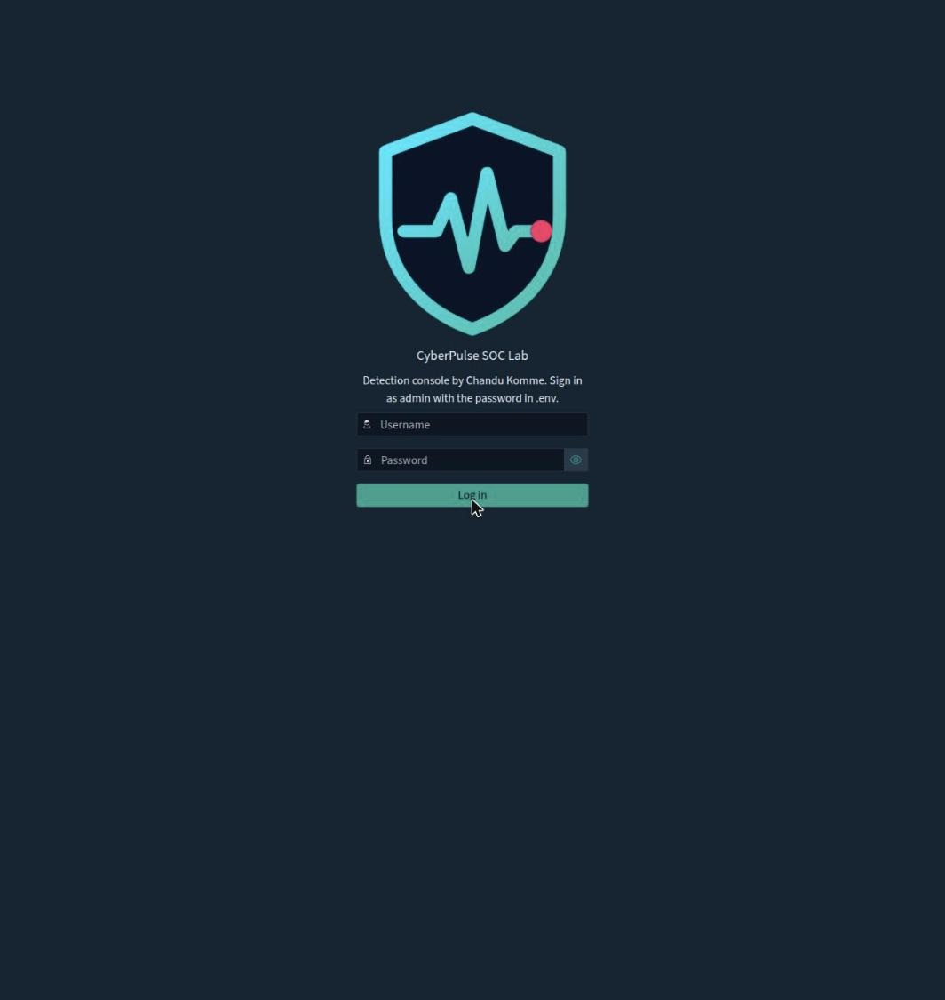
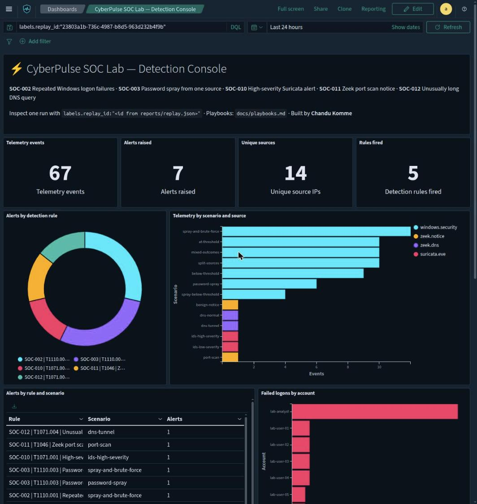
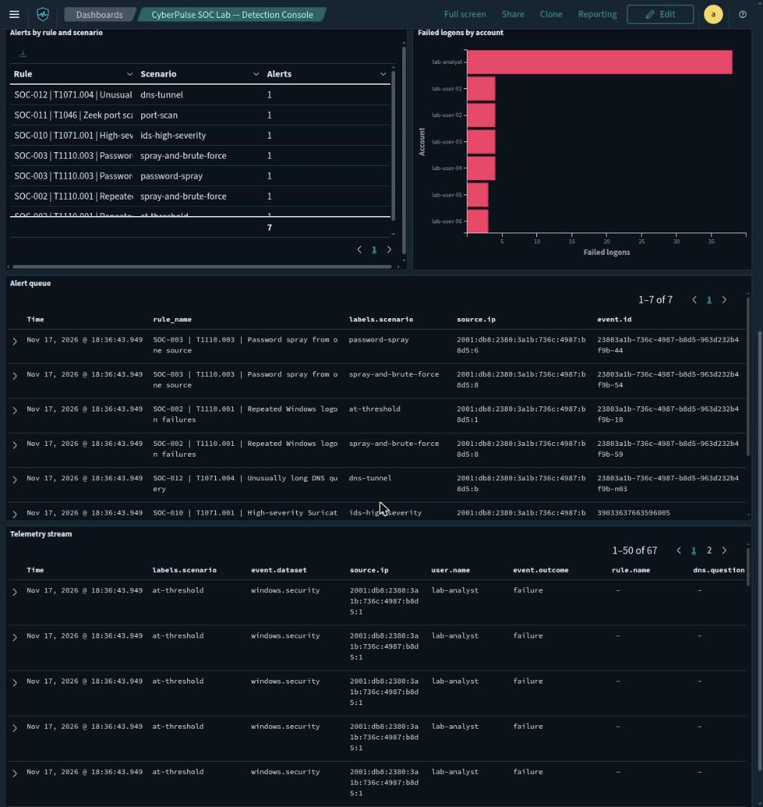
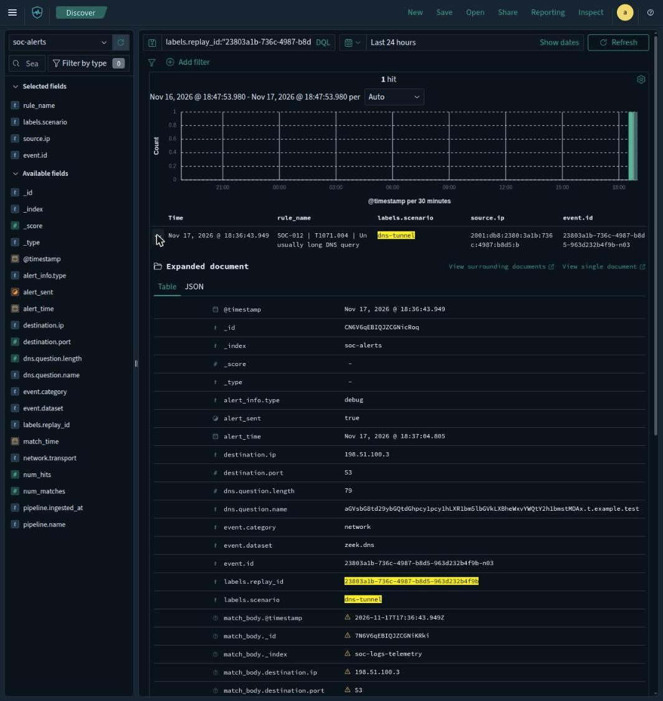
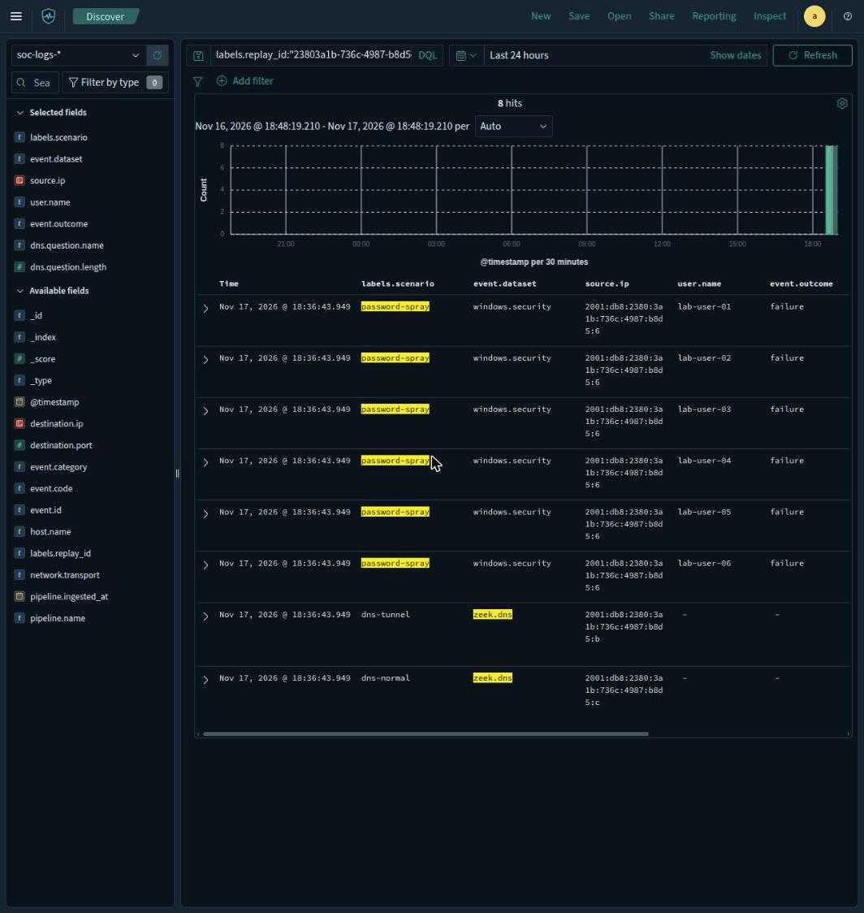
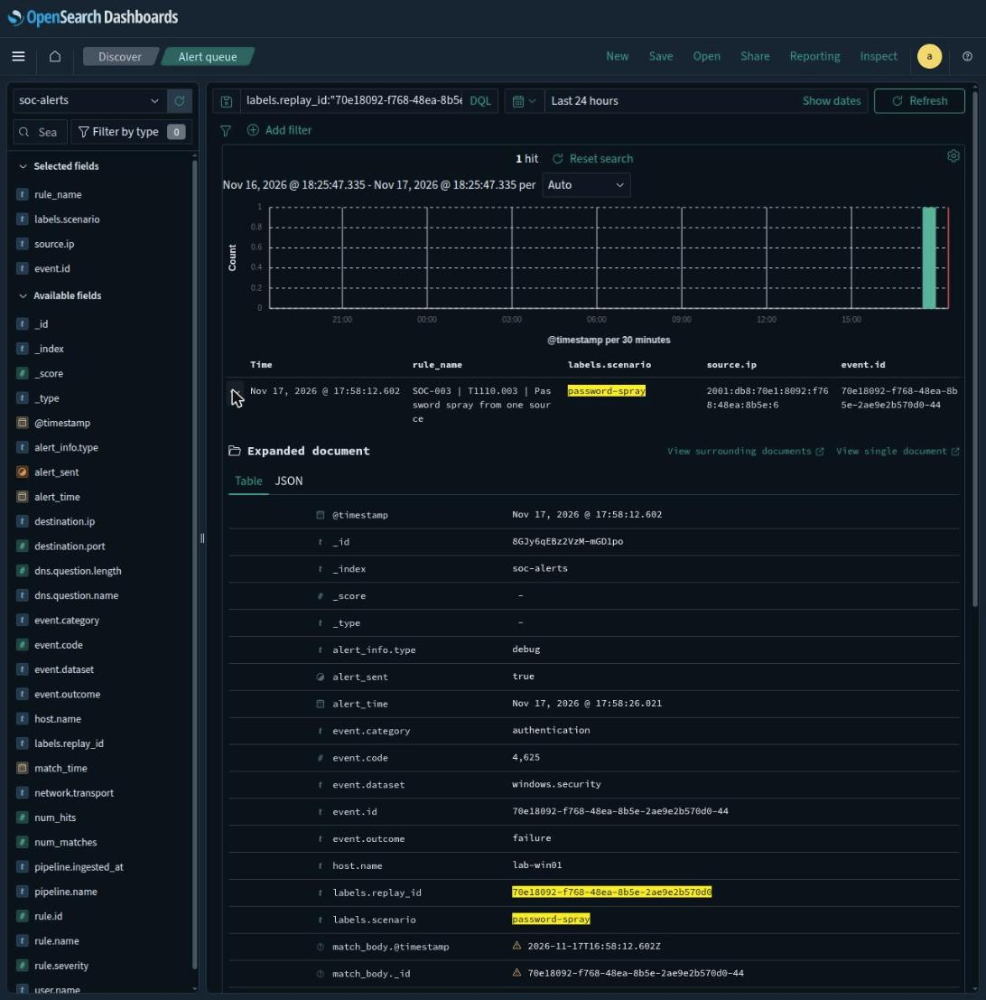
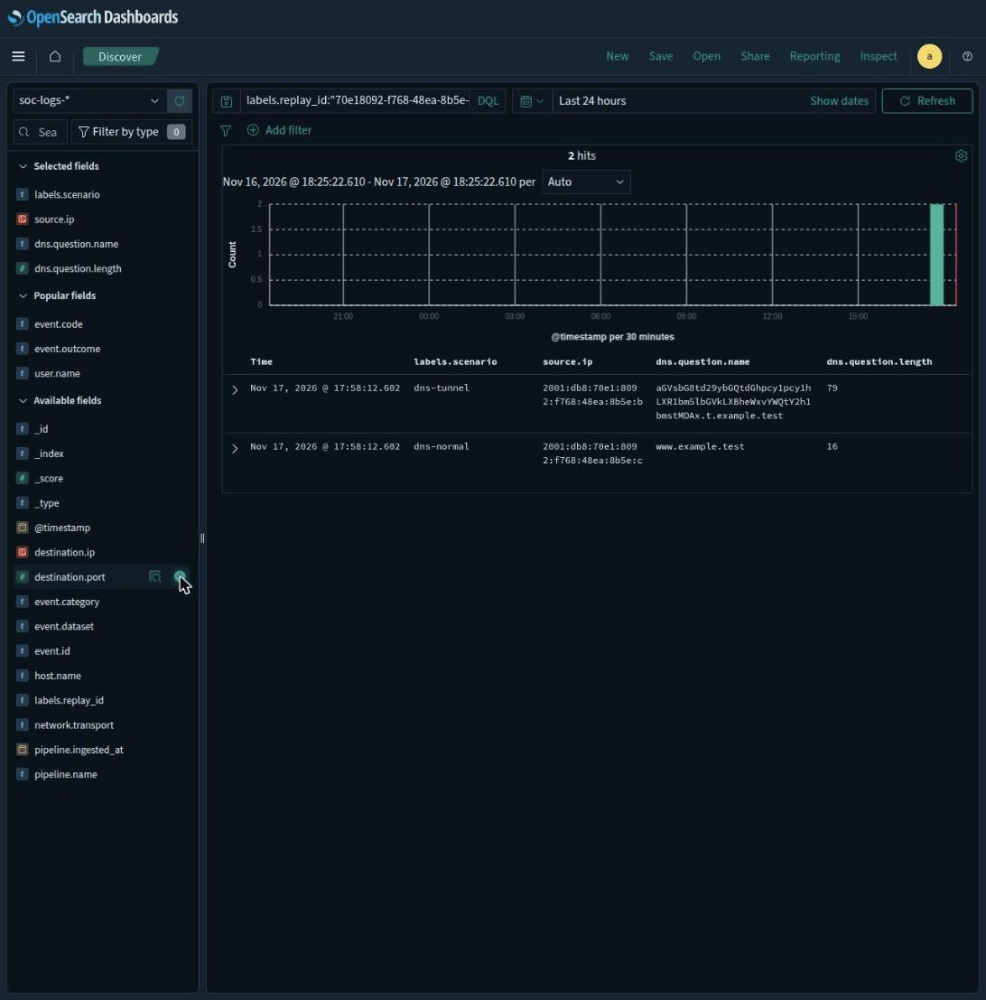
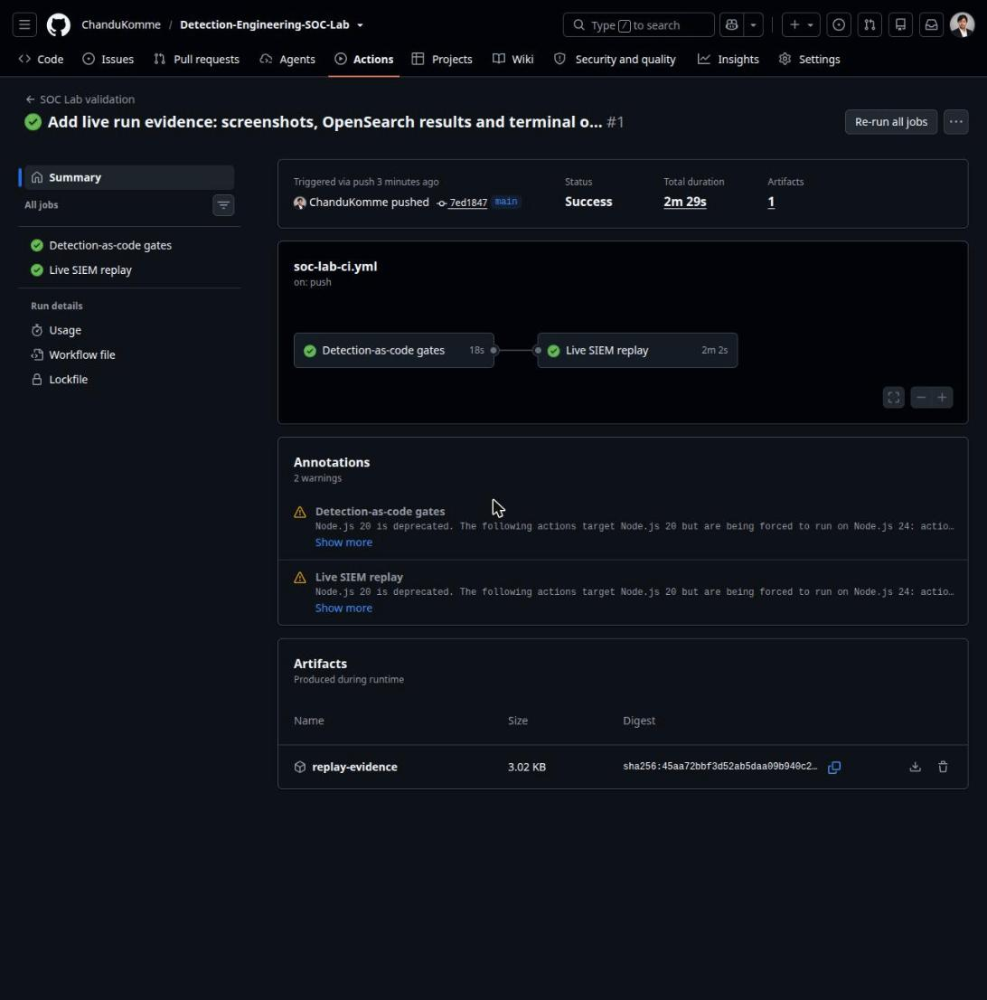
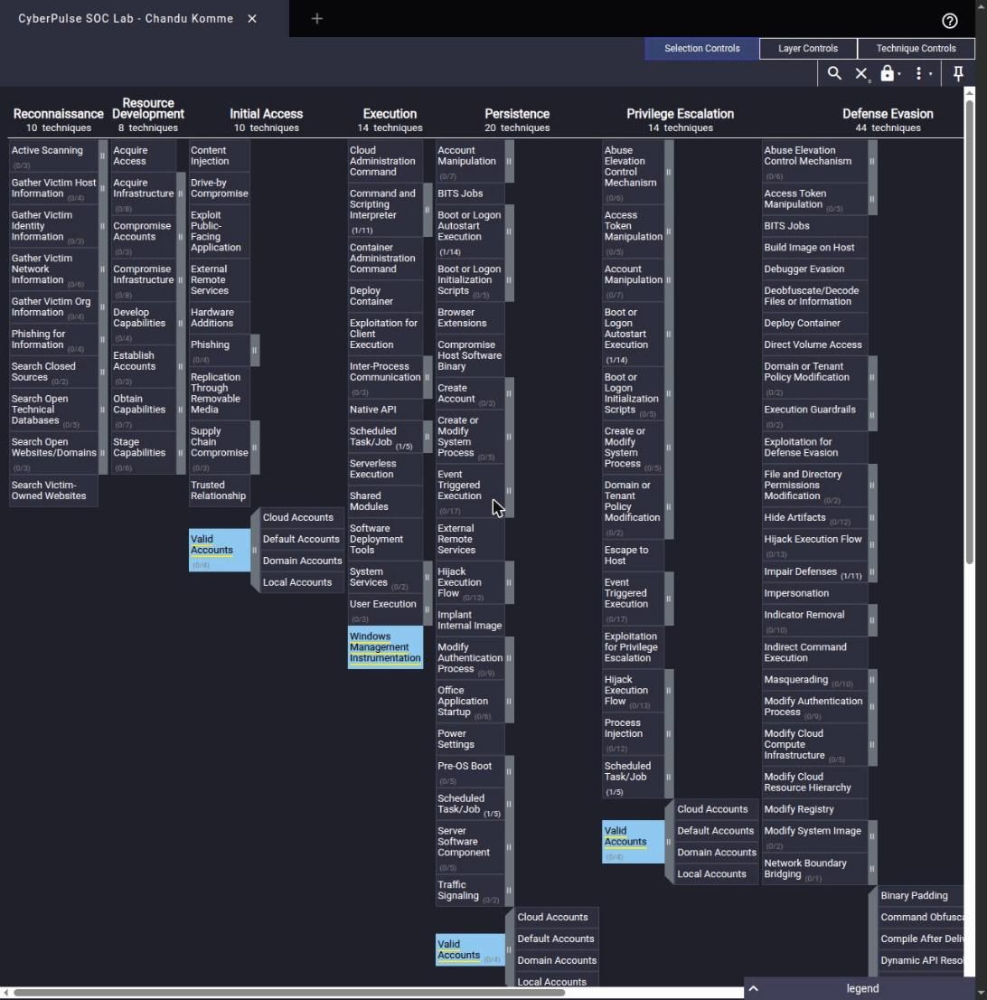
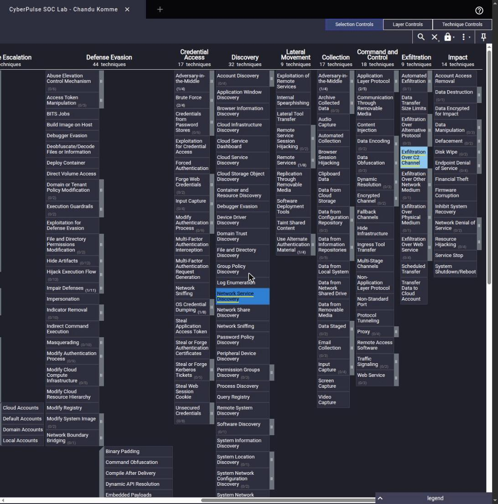

# Evidence — CyberPulse SOC Lab

Proof that the lab works end to end, collected by **Chandu Komme** on 2026-11-17 from a local Docker Compose stack (OpenSearch 2.19.5, OpenSearch Dashboards 2.19.5, Vector 0.61.0, ElastAlert2 2.32.0).

## Result

| Check | Replay `70e18092…` | Replay `23803a1b…` (fresh CyberPulse stack) | CI replay `8310b534…` (GitHub Actions) |
|---|---|---|---|
| Telemetry events indexed | 67 | 67 | 67 |
| Alerts raised | 7 | 7 | 7 |
| Missing or unexpected alerts | 0 | 0 | 0 |
| Near-miss scenarios correctly silent | 6 of 6 | 6 of 6 | 6 of 6 |
| Live rules evaluating | 5 | 5 (77–82 evaluation runs each) | 5 |

The full expected-versus-observed table is in [`live-run/alert-matrix.md`](live-run/alert-matrix.md).

## Contents

| Folder | What it holds |
|---|---|
| [`screenshots/`](screenshots/) | CyberPulse console, alert drill-downs, and telemetry views |
| [`live-run/`](live-run/) | Results read back from OpenSearch: per-scenario counts, every alert with its source event, and rule evaluation status |
| [`terminal/`](terminal/) | Terminal output of setup, both replays, and independent `curl` checks |
| [`ci-run/`](ci-run/) | Replay output from the GitHub Actions run on a clean server |

## Screenshots

| | |
|---|---|
|  | **CyberPulse login page:** branded theme, logo, and subtitle |
|  | **Detection Console** after sign-in: 67 events, 7 alerts, 14 sources, 5 rules, alerts by rule, and telemetry by scenario |
|  | **Alert matrix, failed logons by account, alert queue, and telemetry stream** |
|  | **SOC-012 alert** carrying the 79-character DNS name, port 53, and `match_body._index: soc-logs-telemetry` |
|  | **Password spray:** one source against six accounts, beside the two DNS records |
|  | **SOC-003 alert** linked to source event `…-44` (first replay) |
|  | **DNS tunneling versus normal:** 79 versus 16 characters (first replay) |
|  | **GitHub Actions:** detection-as-code gates and the live SIEM replay both passing on a clean server ([run 44142204654](https://github.com/ChanduKomme/Detection-Engineering-SOC-Lab/actions/runs/44142204654)) |
|  | **MITRE ATT&CK Navigator:** the lab's layer loaded from this repo (initial access to defense evasion) |
|  | **MITRE ATT&CK Navigator:** credential access, discovery, lateral movement, command and control, and exfiltration |

## How it was collected

1. `./setup.sh` started the stack and imported the console. See [`terminal/03-cyberpulse-fresh-stack-23803a1b.txt`](terminal/03-cyberpulse-fresh-stack-23803a1b.txt).
2. `python3 tools/replay.py` replayed 61 Windows events and 6 Zeek/Suricata records and verified the alert matrix. See [`terminal/01-replay-70e18092.txt`](terminal/01-replay-70e18092.txt).
3. The counts and alerts were checked again with direct OpenSearch queries, without the replay script. See [`terminal/02-independent-opensearch-checks.txt`](terminal/02-independent-opensearch-checks.txt).
4. Results for the fresh stack were read back through the console's API proxy into [`live-run/opensearch-results.json`](live-run/opensearch-results.json).
5. Screenshots were taken from the running console.
6. After the push, GitHub Actions rebuilt the stack on a clean server and produced the same alert matrix. See [`ci-run/github-actions-replay-8310b534.txt`](ci-run/github-actions-replay-8310b534.txt).
7. The ATT&CK layer was opened in the MITRE ATT&CK Navigator straight from `detection-rules/attack-navigator-layer.json` on GitHub.

Passwords and other secrets were removed from the terminal output. All addresses come from reserved documentation ranges (`2001:db8::/32`, `198.51.100.0/24`).

---
*CyberPulse SOC Lab — by [Chandu Komme](https://github.com/ChanduKomme)*
